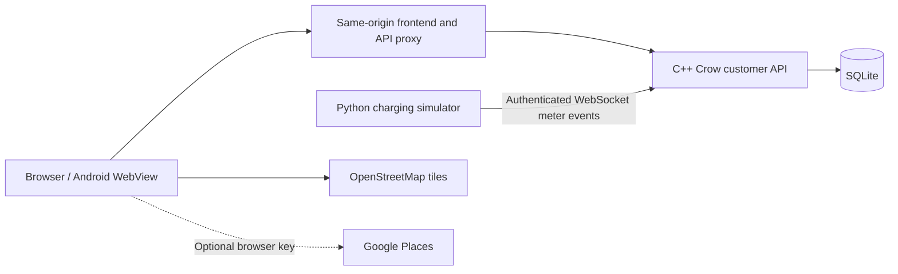

# EV Charging Station Management — Pluggo

Suggested report structure for the implemented project. Adapt the order and length
to your department's rubric. Add your team, course, guide and institution details.

## 1. Abstract

Pluggo demonstrates electric-vehicle charging management through a customer web
interface and a C++ backend. Users choose an electric car, scooter, motorcycle or
cargo three-wheeler, discover compatible demonstration stations, and simulate a
charging session subject to battery targets and a spending limit. The backend
owns session state, connector availability and zero-money receipts, with SQLite
persistence and a separate authenticated charging simulator. An Android WebView
package provides a phone interface to the same frontend. The project demonstrates
software design and charging workflows using fictional profiles rather than
controlling physical chargers or collecting payments.

## 2. Problem statement and objectives

Explain vehicle/connector compatibility, station discovery, exclusive connector
use, budget/target limits, saved history and a clear mobile charging journey.
State which problems are demonstrated using simulated data.

## 3. Scope and requirements

List the implemented customer features, four vehicle profiles, browser location
permission, real street-map tiles, optional Google Places search, simulated QR
verification, live charging, stop, checkout, receipts and saved preferences.
Separate the local customer app, native Android shell and legacy operator/console
modules. Include the relevant hardware/software requirements from deployment/README.md.

## 4. Architecture and data flow

Explain visitor-cookie identity, authoritative server values, persistence and
frontend polling. Distinguish offline preview from server-connected mode.
Include a charging sequence diagram and the database tables for visitors/sessions.

## 5. Object-oriented design

Use the actual declarations in include/ev_system.hpp and src/customer_api.cpp.
Examples you can explain with code excerpts:

- Encapsulation: Vehicle, Charger, Session, ChargingStation and customer Store.
- Composition: ChargingStation owns its charger collection.
- Function overloading: PricingEngine::calculateCost supports flat, time-of-use
  and solar-discount variants in the domain/console module.
- Templates and policy classes: SmartPriorityQueue<T, ScorePolicy>.
- Constructors, copy constructor and destructor: ChargingStation.
- Resource ownership: prepared SQLite statements use RAII cleanup.
- Exception handling: customer API validation/storage failures become HTTP errors.

The advanced range/deadline/queue/solar/emergency algorithms exist in the separate
C++ domain/console and prototype operator modules. Do not claim the current
customer screen invokes all of those algorithms. Describe the customer API's
compatibility, power, target and budget calculations as its implemented flow.

## 6. Implementation

Cover frontend navigation, responsive glass surfaces, 3D loading/fallback, reduced
motion and rendering lifecycle. Explain server validation, connector contention,
visitor isolation, idempotent session creation, simulator metering and receipts.
Describe the Android package as a WebView shell for the current frontend; the
older Flutter demo is a separate implementation.

## 7. Screenshots and walkthrough

Use the latest gallery under docs/ui-audit/soft-edges/. Include Home, cargo vehicle,
Stations, connector selection, charge setup, live charging, checkout, receipt,
Sessions and garage. Explain a short end-to-end journey using CP-01 for the car
and CP-03 for two-wheelers/cargo. Label demonstration values in the report.

## 8. Testing and results

Record actual command outputs, test date and environment. Include C++ domain
checks, API persistence/isolation/validation tests, frontend journeys, responsive
layouts, location denial, WebGL fallback, reduced motion and memory behavior.
Keep browser/emulator evidence separate from physical-phone results. Do not
present one development-machine frame-rate sample as a guarantee for all phones.

## 9. Limitations and future work

- No physical charger, real vehicle battery connection or money collection.
- Google station search needs a restricted key; live-key testing is pending.
- Local visitor identity is implemented; production account login is future work.
- Customer state uses SQLite; PostgreSQL and Keycloak remain scaffolding.
- Free Render hosting is selected but has not been deployed; its SQLite data can
  reset on host restarts or redeployment.
- Physical-device GPS, gestures and sustained performance require phone testing.

## 10. Conclusion, references and appendix

Summarize achieved software behavior and the supported charging demonstration.
Reference libraries, map providers and model sources. Include
frontend/assets/models/CREDITS.md, setup instructions, API contract and test logs.
